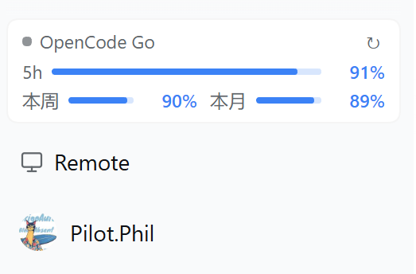

# dsh-opencode-go-quota

在 DeepSeek Harness 左侧栏显示 **OpenCode Go 订阅余量**：5 小时、本周、本月三档，带进度条、重置时间和一键刷新；附带一个 `opencode_go_quota` 工具，可以直接问 agent「查一下额度」。

纯 JavaScript、无构建步骤、无第三方依赖，**不改动 DSH 核心代码**。



---

## 效果

卡片常驻左侧栏底部（`Remote` 那一行上方，独占一行）：

```
● OpenCode Go                    ↻
5h    ▬▬▬▬▬▬▬▬▬▬       93%
本周  ▬▬▬▬▬▬    91%   本月 ▬▬▬▬▬   90%
```

- **三档窗口**：5 小时（OpenCode 的 rolling 窗口）、本周、本月
- **进度条画的是剩余比例**，右侧数值也是剩余百分比（整数）
- **颜色**：蓝色为正常；剩余 ≤30% 转黄；≤10% 或该窗口已用尽转红
- **悬停**任意一行可看到「已用 x% · 重置 时间 · 是否已用尽」
- 点击 `↻` 立即刷新；平时按设置里的间隔自动刷新
- 侧栏折叠成 56px 导轨时卡片自动隐藏

---

## 安装

先确认 `dsh` 命令在 PATH 上（DSH 桌面版自带）。下面的 `<profile>` 换成你的 profile 名（在用的那个，例如 `desktop` / `web`）。

### 方式 A：从 GitHub 安装（推荐）

```bash
dsh plugin --profile <profile> add "github:PilotPhil/dsh-opencode-go-quota#<commit-sha>"
```

> `#` 后面的 commit SHA 建议写全（40 位），见 [commits 页](https://github.com/PilotPhil/dsh-opencode-go-quota/commits/main)，这样可以锁住安装内容，避免后续推送悄悄改掉已安装的版本。
> PowerShell 里 `#` 是注释符，**参数必须加引号**，否则 SHA 会被吃掉。

### 方式 B：从本地目录安装（开发时用）

```bash
dsh plugin --profile <profile> add "link:<插件目录绝对路径>"
```

`link:` 会把目录接进 profile，之后改代码只要重启 DSH 就生效。

### 方式 C：手动写进 profile patch

在 profile 的 `cordis.patch.yml` 里加：

```yaml
- insert:
    - id: opencode-go-quota
      name: dsh-opencode-go-quota
```

装完**重启 DSH**。启动后左侧栏底部应出现上面的卡片；若没有，检查 DSH 日志里有没有 `opencode-go-quota` 的加载失败信息。

---

## 配置 API key

只需要一把 OpenCode API key（`oc_sk_...`，在 <https://opencode.ai/console> 的 Account › Personal API keys 创建）。三种来源，按优先级：

1. **卡片里粘贴** —— 未配置或查询失败时，卡片下方会出现输入框；输入后点「保存」。
2. **设置页** —— 设置 → 插件 → `dsh-opencode-go-quota` → API key。保存前会先用这把 key 真跑一次接口，通过才写入。
3. **环境变量 / `.env`** —— 变量名 `OPENCODE_GO_API_KEY`。

> 变量名与 DSH 里 OpenCode Go provider 的 `apiKeyEnv` 一致，所以**如果你已经在这个 profile 里配好了 OpenCode Go 推理用的 key，这个插件可以直接用，不用再配一遍**。

key 只存在于 Host 进程侧：卡片所在的浏览器端从不接触密钥，也不会直连 opencode.ai。

---

## 设置项

位置：**设置 → 插件 → dsh-opencode-go-quota**（该 bundle 自己的页面）。

| 设置 | 取值 | 说明 |
| --- | --- | --- |
| 自动更新 | 关闭 / 1 / 5 / 10 / 15 / 30 / 60 分钟 | 默认 5 分钟；改完立即作用于卡片，不用重开。存在浏览器 `localStorage`，只影响本机这一份 UI |
| API key | 密码输入 + 保存 | 存入 Host 凭据库；保存前先校验，失败会给出具体原因（401 / 未订阅 / 网络） |

---

## Agent 工具

插件向会话注册了一个工具：

```jsonc
opencode_go_quota({ "refresh": true })   // refresh 可选，绕过 30 秒缓存
```

返回示例：

```
OpenCode Go allowance: 5h 93% left, resets 2026-11-09T11:09:59.000Z ·
week 91% left, resets 2026-11-16T00:00:00.000Z ·
month 90% left, resets 2026-12-06T11:38:02.000Z.
Percentages are each window's own allowance.
```

直接对话里说「查一下 OpenCode Go 还剩多少」即可。

---

## 数据来源

```
GET https://opencode.ai/zen/go/v1/usage
Authorization: Bearer oc_sk_...
```

返回：

```jsonc
{
  "usage": {
    "rolling": { "status": "ok",           "percent": 7,   "resetsAt": "2026-11-09T11:09:59.000Z" },
    "weekly":  { "status": "ok",           "percent": 9,   "resetsAt": "2026-11-16T00:00:00.000Z" },
    "monthly": { "status": "rate-limited", "percent": 100, "resetsAt": "2026-12-06T11:38:02.000Z" }
  }
}
```

- `percent` 是**已用**百分比（0–100），本插件显示 `100 - percent`
- `status: "rate-limited"` 表示该窗口额度已用尽，OpenCode 会拒绝请求直到 `resetsAt`
- `resetsAt` 为 ISO-8601 时间戳（UTC），界面上转成本地时间

两点要清楚：

1. **三档不同单位不可互算**：OpenCode 的规则是「每个窗口的额度 = 该模型月额度的 20% / 50% / 100%」，接口只给百分比，不给美元金额。想看金额得自己乘上对应模型的月额度。
2. **接口没有套餐档位**：Go / Go Plus / Go Teams 的区别只体现在底层额度和「没有订阅时返回 403」上，响应结构相同。

---

## 工作原理

插件由两半组成，都不改 DSH 核心：

**Host 半（`index.js`）**

- 用 DSH 的凭据服务解析 `OPENCODE_GO_API_KEY`（凭据库优先，其次进程环境 / `.env`）
- 请求用量接口，带 30 秒缓存（卡片轮询与工具调用共享一次请求）
- 对外提供两条出口，同一份实现：
  - `GET /api/opencode-go-quota` 给卡片读；`POST` 用于保存并校验 key
  - agent 工具 `opencode_go_quota`
- 密钥全程不出 Host 进程

**Client 半（`client.js`）**

- 把卡片挂进侧栏 `sidebar.footer.action` 座位，并插成该行的第一个子项
- 用一条 `:has()` 规则让这一排 `flex-wrap: wrap`，卡片自身 `flex: 0 0 100%`，于是**独占一行**、排在 `Remote` 上方，且仍在布局流里，不会遮挡任何侧栏内容
  （与 `dsh-tps` 采用相同做法）
- 设置面板注册在 `plugins.bundle.config`，按包名 keyed
- 中英文文案走 DSH 的 locale 服务，主题色走 `--dsw-alias-*` token；进度条固定使用蓝色 `#3b82f6`，避免某些主题把品牌色渲染成近黑

---

## 兼容性

- 在 DSH **0.2.2-rc.1** 上开发与验证
- 卡片依赖侧栏的 `sidebar.footer.action` 座位以及 `:has()` 换行；如果 DSH 之后改动侧栏结构，这一处可能需要跟着调整一行
- 纯 ESM、无构建脚本、无运行时依赖，安装不会触发 pnpm 的构建授权提示

## 已知限制

- 用量接口是官方文档未公开的端点（逆向自 OpenCode Console 客户端），**OpenCode 改动字段或路径时本插件会失效**；代码对缺失字段是逐窗口降级的，不会整块白屏
- 只有百分比，没有金额，也没有套餐档位
- 「自动更新间隔」存在浏览器本地，不随 profile 同步
- 侧栏折叠成导轨时卡片隐藏，不提供浮窗形态

---

## 开发

```
dsh-opencode-go-quota/
├── index.js          # Host 半：凭据解析、用量查询、HTTP 路由、agent 工具
├── client.js         # Client 半：侧栏卡片、设置面板
├── cordis.patch.yml  # bundle 声明（插入 Loader 行）
├── locale/{en,zh}.json
├── icon.svg
└── package.json
```

本地联调：

```bash
dsh plugin --profile <profile> add "link:/absolute/path/to/dsh-opencode-go-quota"
```

改完 `client.js` / `index.js` 重启 DSH 生效（浏览器端的热更取决于 DSH 版本是否开着开发监听）。

---

## License

MIT
